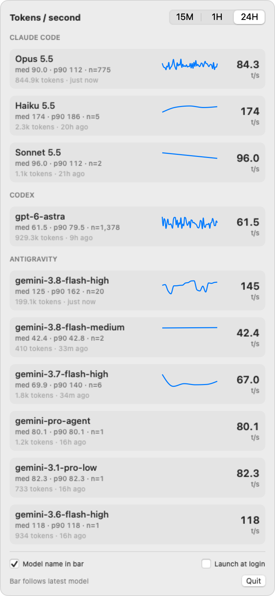

# Tokometer

A tiny macOS menu bar app that shows how fast your coding agents are generating, in **tokens per second**, per model, for **Claude Code**, **Codex** and **Antigravity**.

<p align="center">
  <picture>
    <source media="(prefers-color-scheme: dark)" srcset="docs/screenshot-dark.png">
    
  </picture>
</p>

No API keys, no proxies, no network access. Tokometer only reads the session logs these tools already write to your home directory.

## Features

- Live tokens/sec of the most recently active model right in the menu bar (or pin any model)
- Per-model median, p90, response count, token volume and a sparkline
- 15 min / 1 h / 24 h windows
- Fast incremental scanning: only newly appended log data is read
- Optional launch at login

## Install

Requires macOS 14 or later.

**From a release:** download `Tokometer-<version>.zip` from [Releases](https://github.com/dzeveckij/tokometer/releases), unzip, and move `Tokometer.app` to Applications. The app is not notarized, so on first launch right-click it → **Open**, or run:

```bash
xattr -dr com.apple.quarantine /Applications/Tokometer.app
```

**From source** (needs Xcode 16 or the Swift 6 toolchain):

```bash
git clone https://github.com/dzeveckij/tokometer.git
cd tokometer
./build.sh --install   # builds, copies to ~/Applications and launches
```

## How it measures

Speed is **output tokens ÷ wall-clock time** of a single model response, measured from when the request started (your prompt or the previous tool result) to when the response finished. That includes time to first token, so it reflects how fast the agent *feels*, not raw decode speed.

| Tool | Reads | Tokens | Timing |
|---|---|---|---|
| Claude Code | `~/.claude/projects/**/*.jsonl` | `message.usage.output_tokens` | parent prompt/tool result → last content block of the message |
| Codex | `~/.codex/sessions/`, `~/.codex/archived_sessions/` | `token_usage_record.usage.output_tokens` | last input (task start, tool output, user message) → usage record |
| Antigravity | `~/.gemini/antigravity{,-cli,-ide}/conversations/*.db` | step metadata usage | step created → step completed |

To keep numbers honest:

- Responses under **200 output tokens** are ignored, because for short replies the wait for the first token dominates and the rate reflects latency rather than speed.
- Responses duplicated by resumed or forked sessions are counted once.
- Only the last 24 hours are kept. Older log files are never opened.
- The menu bar falls back to an icon after 30 minutes without activity, so it never shows a stale speed.

The big number on each row is the median of that model's last 5 responses.

Log formats are undocumented and change between tool versions. If a tool stops showing up, please open an issue.

## Development

```bash
swift build                                  # debug build
.build/debug/Tokometer --dump                # scan from scratch and print per-model stats
.build/debug/Tokometer --snapshot out.png    # render the panel to a PNG (add --dark for dark mode)
```

To publish a release (builds locally, tags, pushes, and uploads the zip with `gh`):

```bash
./release.sh 0.1.0
```

State lives in `~/Library/Application Support/Tokometer/cache.json` and can be deleted at any time.

Source layout:

- `Scanner.swift`: incremental JSONL reader plus the Claude Code and Codex parsers
- `Antigravity.swift`: SQLite + minimal protobuf reader for Antigravity
- `Store.swift`: samples, stats, settings
- `App.swift`: menu bar UI

