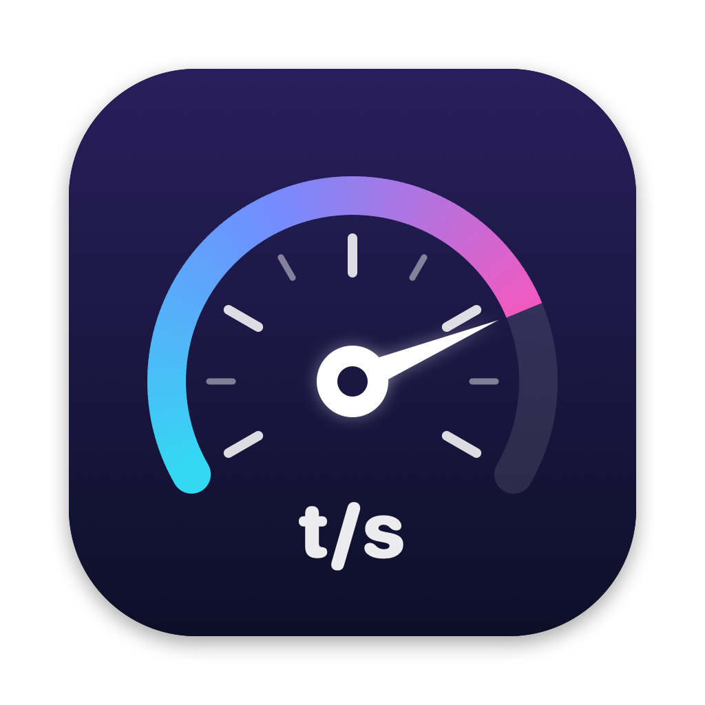

<p align="center"></p>

# Tokometer

A tiny macOS menu bar app that shows how fast your coding agents are generating, in **tokens per second**, per model, for **Claude Code**, **Codex**, **Antigravity** and **OpenCode**.

<p align="center">
  <picture>
    <source media="(prefers-color-scheme: dark)" srcset="docs/screenshot-dark.png">
    
  </picture>
</p>

No API keys, no proxies, no network access. Tokometer only reads the session logs these tools already write to your home directory.

## Features

- Live tokens/sec of the most recently active model right in the menu bar (or pin any model)
- Per-model median, p90, response count, token volume and a sparkline
- **Compared with usual:** each model's recent speed is shown against its own 7-day median (↑12% green, ↓18% orange/red), and the menu bar gets an arrow when the current model is clearly off its usual pace
- **History:** 15 min / 1 h / 24 h windows from individual responses, plus 7 day / 30 day windows from daily summaries kept for 30 days
- Collapsible providers: click a provider header to fold its models into a one-line summary
- Fast incremental scanning: only newly appended log data is read
- Optional launch at login

## Install

Requires macOS 14 or later.

**With Homebrew:**

```bash
brew tap dzeveckij/tokometer https://github.com/dzeveckij/tokometer
brew install --cask tokometer
```

**From a release:** download `Tokometer-<version>.zip` from [Releases](https://github.com/dzeveckij/tokometer/releases), unzip, and move `Tokometer.app` to Applications. The app is not notarized, so on first launch right-click it → **Open**, or run:

```bash
xattr -dr com.apple.quarantine /Applications/Tokometer.app
```

**From source** (needs Xcode 16 or the Swift 6 toolchain):

```bash
git clone https://github.com/dzeveckij/tokometer.git
cd tokometer
./build.sh --install   # builds, copies to ~/Applications and launches
```

## How it measures

Speed is **output tokens ÷ wall-clock time** of a single model response, measured from when the request started (your prompt or the previous tool result) to when the response finished. That includes time to first token, so it reflects how fast the agent *feels*, not raw decode speed.

| Tool | Reads | Tokens | Timing |
|---|---|---|---|
| Claude Code | `~/.claude/projects/**/*.jsonl` | `message.usage.output_tokens` | parent prompt/tool result → last content block of the message |
| Codex | `~/.codex/sessions/`, `~/.codex/archived_sessions/` | `token_usage_record.usage.output_tokens` | last input (task start, tool output, user message) → usage record |
| Antigravity | `~/.gemini/antigravity{,-cli,-ide}/conversations/*.db` | step metadata usage | step created → step completed |
| OpenCode | `~/.local/share/opencode/opencode.db` (or `$XDG_DATA_HOME/opencode`; older versions' `storage/message/*.json` too) | assistant message `tokens.output` + `tokens.reasoning` | message created → stream finished (tool execution excluded) |

Models are labeled by what actually ran:

- **Codex:** fast mode (`service_tier = "priority"`) is shown separately as "· Fast". Sub-agent sessions inherit their parent session's tier; sessions that never log one use `service_tier` from `~/.codex/config.toml`.
- **Claude Code:** `usage.speed` marks fast mode the same way; the model is the one the API reports for each response.
- **OpenCode:** models from OpenCode's own provider are shown by name; other providers keep a prefix (e.g. `openrouter/claude-sonnet-4-5`), since the same model can run at very different speeds through different providers. A non-default variant is shown like a tier (e.g. "· High").
- **Antigravity:** the model you pick is often served by a different backend (e.g. `gemini-3.8-flash-high` by `gemini-3.8-flash-exp-a` or `gemini-3.8-flash-n`, which differ noticeably in speed). Rows show the backend that answered, with "requested …" underneath.

To keep numbers honest:

- Responses under **200 output tokens** are ignored, because for short replies the wait for the first token dominates and the rate reflects latency rather than speed.
- Responses duplicated by resumed or forked sessions are counted once.
- Only the last 24 hours of individual responses are kept, and older log files are never opened. 7 D and 30 D come from daily summaries (a sample of speeds plus response and token counts, per model per day) kept for 30 days. On first launch Tokometer reads the previous 30 days of logs once, in the background, to fill them in; after that only new log data is read.
- The menu bar falls back to an icon after 30 minutes without activity, so it never shows a stale speed.

The big number on each row is the median of that model's last 5 responses.

Log formats are undocumented and change between tool versions. If a tool stops showing up, please open an issue.

## Development

```bash
swift build                                  # debug build
.build/debug/Tokometer --dump                # scan from scratch and print per-model stats
.build/debug/Tokometer --dump --days 30      # same, over the last 30 days
.build/debug/Tokometer --snapshot out.png    # render the panel to a PNG (--dark, --collapse antigravity)
swift test                                   # parser tests
```

To publish a release (builds locally, tags, pushes, and uploads the zip with `gh`):

```bash
./release.sh 0.1.0
```

State lives in `~/Library/Application Support/Tokometer/`: `cache.json` (scan state, safe to delete) and `history.json` (daily summaries; deleting it resets 7 D / 30 D and the usual-speed baseline).

The icon's source is `Resources/icon.svg`; `swift scripts/make-icon.swift` renders it to `Resources/AppIcon.icns` and `docs/icon.png`.

Source layout:

- `Scanner.swift`: incremental JSONL reader plus the Claude Code and Codex parsers
- `Antigravity.swift`: SQLite + minimal protobuf reader for Antigravity
- `OpenCode.swift`: OpenCode SQLite (current and older layouts) and JSON-file reader
- `History.swift`: daily per-model summaries for 7 D / 30 D and the usual-speed baseline
- `Store.swift`: samples, stats, settings
- `App.swift`: menu bar UI

